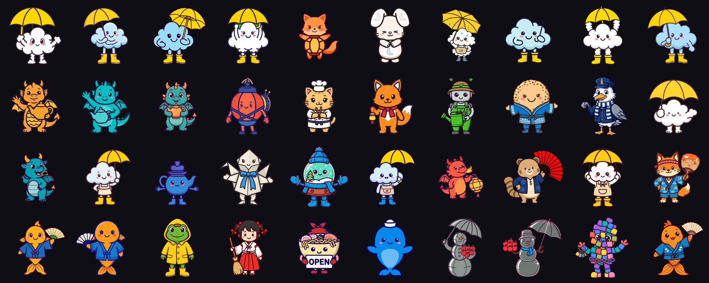
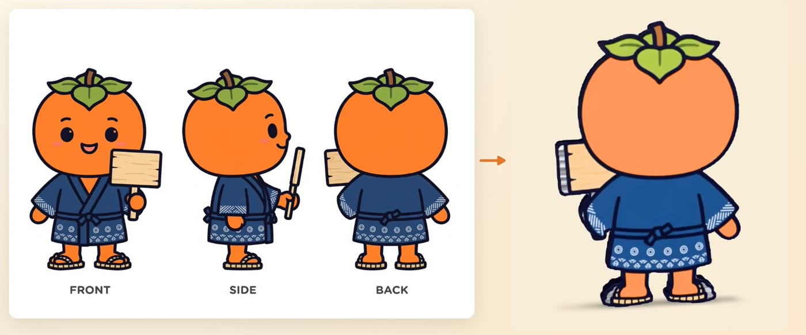
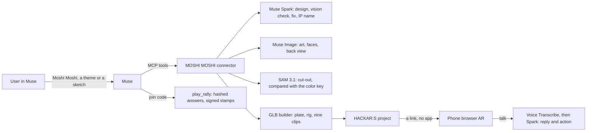

# MOSHI MOSHI — Say hello to your characters

[](https://hackathon-ar-creator.vercel.app/gallery)

**[Watch the 3-minute demo](https://youtu.be/zSJwPuPBn2Y)** · **[Make one in your browser, no Muse needed](https://hackathon-ar-creator.vercel.app/try)** · **[Turn any of these 40 in 3D and talk to it](https://hackathon-ar-creator.vercel.app/gallery)** · **[Every run, with its failures](RUNS.md)** · **[What was built when](BUILT_DURING.md)**

**Talk to Muse, and a character you can touch and talk to is born inside HACKAR:S — our production WebAR platform.** Hand interactions designed for AR glasses, tried on today's phones.

An MCP connector for the **Meta Global AI Developer Hackathon** (Cerebral Valley, Oct 26 – Nov 4, 2026), built by HACK IT INC. (solo).

Say the passphrase "Moshi Moshi" in Muse to start, give a one-word theme, and this connector:

1. **Composes** the character server-side with the Meta Model API — `muse-spark-1.3` designs the title, overlay text, base color, the magic spell, and the character's **name and personality** (JSON); `muse-image-1.0` draws the theme at the same time (the drawing needs only the theme, not the design), plus face variants (happy / surprised / sad / angry) via image edits, each re-cut with the original silhouette mask. Token usage is logged on every run as Tooling evidence. Muse Spark then **checks its own artwork with vision**: it grades the 2D cut-out on a plain gray background (not the finished 3D model), and if it fails (holes, a cropped limb, something the theme asked for) it writes the fix into a new image prompt and, when time allows, redraws once. If the drawing still fails, the better of the two goes forward and `publish_ar` refuses it until the user decides.
2. **Builds a semi-3D model on the server** (`api/glb.mjs`, pure JS): the flat artwork becomes a plate with real thickness (1/15 of its height), an edge-coloured rim, a baked ground shadow, a 3-joint squash-and-stretch rig, and **nine named animation clips** — `idle` / `happy` / `surprised` / `sad` / `angry` / `talk` / `dangle` / `land` / `zap`.
3. **Publishes into HACKAR:S** (our production WebAR platform) as a real project: the model, one of five real three.js **Ultra Elements** spells (lightning / fire / frozen lightning / starfall / light pillar), expression switching, and **Hand Play** — pinch the character with your fingers to pick it up and carry it, press the talk button and it listens and answers in character (voice transcription + Spark reply + speech, with an emotion that changes its face and moves), hold up a palm to cast its spell. Ask it to jump, spin or cast its spell and it does — Spark returns an action with its reply (speech is read out with the phone's built-in voice). It moves calmly on its own (looking around, the occasional hop), lives with you as a small pet (feed / play / talk / pet from the buttons at its feet; it grows, gets hungry, sleeps at night and now and then leaves a mess you clean with a fingertip),.
4. **Certifies** the creation with a signed certificate page (one per creator) that links the published work and prints the Meta Model API usage.

## Who it is for

The first user is the person behind a mascot at a small shop or a local festival, who usually has the character already, often as a three-view sheet. That is why `/try` keeps their art instead of drawing a new one.

[](https://hackathon-ar-creator.vercel.app/try) Japan is full of them: the 2015 Yuru-chara Grand Prix alone had [1,727 entries](https://www.travelvoice.jp/20151124-55505), 1,092 of them local mascots. One AR character still takes a designer, an editor and device testing, so most of them never get one. Here that person gives a theme or a sketch in a chat, checks the result and decides whether to publish; the drawing, cut-out, 3D build, hosting and the rally are done for them. No one outside our team has tried this yet.

## Try it

Demo video: https://youtu.be/zSJwPuPBn2Y

The quickest start is the page at https://hackathon-ar-creator.vercel.app/ (QR code and links).

- **Make your own, in a browser, no Muse:** https://hackathon-ar-creator.vercel.app/try . Give a theme and in 1–2 minutes its 3D model turns on the page, with its nine clips. Type to it and Muse Spark answers in character and picks an emotion and an action (`public/stage.js` plays them with simple moves, a light copy of the phone's). Then publish it and make a stamp rally if you want one. The page makes the same `start_create`, `compose_ar`, `publish_ar` and `make_play` calls Muse makes, and it asks the same questions before publishing a failed drawing or someone else's IP.
- **Bring your own character:** the same page takes a picture or a three-view sheet, and has a test sheet to try it with. On a clean white page the drawing itself is used, cut out and scaled, and no model redraws it. A sheet whose views stand side by side gives both the front and the back: Muse Spark looks at the page to say which view is which (it read front, side, back correctly in three different orders), the back is fitted to the front's outline, and if Spark cannot read the page the left view is taken as the front, the right as the back, and the page says so. With no back view the back is drawn by Muse Image, as usual. Small parts that float away from a view can drop out, so check the model as it turns before publishing. A photo of a drawing goes through a Muse Image edit that keeps the design and removes what is around it, which is close but not pixel-exact. Expressions are still image edits. The side view of a sheet is not used, because the model is a plate. Before publishing, the page asks whether you hold the rights.
- **On a phone, no app:** open https://hackar-s.com/slam-ar/350e9339-746e-4d64-86be-52161c4bd46b in the browser, aim at the floor, then pinch, talk and show your palm. Allow the camera and microphone. This is the cloud from the video: Muse read the sketch and the connector built it, with no retouching. Sunny, the festival mascot, is at https://hackar-s.com/slam-ar/efd6db6a-a5c0-45ee-9503-7a27fe4ddb21 (made before the back view existed, so its back is a solid color).
- **On a laptop:** the same cloud in our [AR emulator](https://hackar-s.com/slam-emulator.html?params=https%3A%2F%2Fpgyuabajrswdkzuksqfu.supabase.co%2Fstorage%2Fv1%2Fobject%2Fpublic%2Fdeployments%2F350e9339-746e-4d64-86be-52161c4bd46b%2Foverlay-params.json). Press Place Content.
- **In Muse:** add `https://hackathon-ar-creator.vercel.app/mcp` as a custom connector, then say "Moshi Moshi".
- **The goldfish from the one-take in the video:** https://hackar-s.com/slam-ar/17cfa3cb-2757-426f-928f-9d63ec3b9d6a , and "Join MATSURIP-5006" in Muse for its rally.
- **Stamp rally in Muse:** with the connector added, say "Join DRIZZLY-7913". The same rally on the web, without Muse: https://hackar-s.com/play/6dc342aa-7e20-44c0-b53e-50b0150a9ccc

## In production

- **Real output, real platform.** Every successful run creates a project in HACKAR:S (hackar-s.com), the WebAR platform we already run for brand and event AR. Since March 2026, 79 outside accounts have published 130 projects on it by hand in the editor (accounts on email domains other than ours, projects with a published build, all created before the hackathon began; we did not check each account one by one). Those are the platform's numbers, not this connector's: none of them has used it yet. Of those projects, the 43 saved more than a minute after they were created had a median of 23 minutes between creation and last save, with the artwork made elsewhere. That is elapsed time, not working time, and not a controlled comparison with the time below. The only link the user gets is that hackar-s.com URL.
- **Time.** Since the drawing stopped waiting for the design, 20 direct calls took 64–136 s from theme to a live link, mean 84 s, down from 102 s. Publishing is about 27 s of that. These are server calls. In Muse the wait is longer, because Muse thinks between calls.
- **Every run is listed.** [RUNS.md](RUNS.md) has all 41 of our own runs (Nov 4 ET, Nov 5 in Japan), with their failures. 40 ended with a published link, some only after a retry or with a failed check. Run 37 did not: its model was too large to store, which is now fixed. Nobody outside the team has used it yet, so these numbers say the system works, not that people want it.
- **What the runs found.** Muse dropped silent calls at about 50 seconds: fixed by keeping the call alive, and the Muse runs after that (13, 22, 29, 30, 31, 39, 40) had no dropped call. Run 41 did lose one reply, described under Known limits. Muse could not always copy a card of several KB (run 22): fixed by making it a 27-character pointer, and no Muse run since then failed on copying the card (in run 29 we chose to remake a drawing that failed the check, and run 41 lost a reply, described under Known limits). SAM left out what characters hold: the self-check kept reporting "missing open yellow umbrella", the logs showed a low match with the color key every time, and themes that failed before now pass first time (runs 26, 27). In runs 26–36, 9 of 11 runs scored 10/10 at once, including a person, a green character and a sign with text (runs 33–36). One GLB was too large to store and lost its back view: back plate halved. A later test of the refusal found the same limit again, this time with no model to publish (run 37): the textures now shrink until the model fits, while the outline stays cut at full size, and in Muse that has already saved runs 39 and 40.
- **When a drawing still fails, or uses someone else's IP.** `publish_ar` refuses it: no project is created until the user has heard why and agreed (`confirmed: true`). Spark names any character or brand in the theme that belongs to someone else, so "Pikachu" gets a question first, and if Spark gives no answer the same question comes up. It is a question, not a rights check, and Spark can still miss a name. The mark is saved with that drawing, so a new drawing clears it and an old card cannot. Muse passes the agreement, so this stops an accident, not a model that ignores the user.
- **On a real iPhone.** The cloud, by voice, in Safari on a real floor: "今日の天気は？" was heard in 1.3 s, the whole answer took 4.0 s, and Spark chose `action: spin`, which the character performed. This is one check, shown in the video, not a test across devices.
- **Known limits.** In the one-take Muse says a theme is cut at 60 characters; that is its memory of an older version, and the limit is now 160. In run 41 Muse's client lost a reply: by Muse's own account of its tool history, the first try failed in a second ("MCP request did not complete"; our log shows it never reached `tools/call`) and the retry ended at about 53 seconds with "event stream ended before the matching result", although our log shows the compose finishing at 49 seconds. Muse then called again over curl, which drew a second character. A client we wrote to read the stream the same way got its result at 49.3 seconds. That does not rule out something specific to Muse, and we do not know what ended that stream. What changed: a card older than the character is treated as a possible lost reply, so the same request (theme, spell and language) within five minutes, before publishing, gets the same character back. `tools/test_session.mjs` covers it, and on the live server the repeat took 4 seconds and drew nothing. It has not met another real lost reply in Muse yet. The first message in a new Muse chat has twice taken minutes before reaching our server; that wait is on the Muse side and we do not know why. Rate limits are kept per server instance.
- **Backs.** A back drawing can fall outside the front's outline, which cut its line. Since the last day the back is placed by its overlap with the silhouette, and the outline follows the edge of the plate in the drawing's own line colour. The 40 characters in the gallery were made before this and keep their older backs.
- **Self-check proof.** When Muse Spark rejects a drawing and the redraw scores higher, the first drawing, the redraw, both scores and the fix it wrote go on the creation certificate. Example: 4/10 "no open yellow umbrella", redrawn to 10/10 ([first drawing](https://pgyuabajrswdkzuksqfu.supabase.co/storage/v1/object/public/deployments/ar-creator/cb151e3e-2cfd-41dd-a5d1-f7bf7500feb7.png), [redraw](https://pgyuabajrswdkzuksqfu.supabase.co/storage/v1/object/public/deployments/ar-creator/988cefd4-32cc-4b77-a80d-ce0f34202e6e.png)).
- **Price.** HACKAR:S lists two paid plans, ¥1,980 and ¥9,800 a month, on hackar-s.com. These are list prices of the platform; the connector is not sold yet.
- **Cost per character.** Without a redraw, about six Muse Image calls (artwork, four expressions, back view) at $0.01 each plus a few thousand Muse Spark tokens, roughly $0.07. A redraw repeats the image work and costs more; edit calls are not in the usage shown in chat.
- **Honest failure.** If publishing fails, the user is told so; no other URL is substituted.
- **Guard rails.** Rate limits on the paid tools and on talk, per IP and overall, kept in memory per server instance, plus pause switches (`AR_PAUSED`, `TALK_PAUSED`).

If the model API is unavailable, composition falls back to a deterministic template, but publishing still needs a generated image and model; it fails honestly rather than substituting another URL.

## What comes next

- **Creators sign in.** Today the connector publishes under one account of ours. Next, a character made in Muse lands in its creator's own HACKAR:S account, so the plans the platform already has apply to it.
- **A place where Japanese IP gathers**, with rights confirmed and characters reviewed. Not built.
- **Glasses hardware.** The Ray-Ban Display app has only run in Meta's simulator.

## What was built when (hackathon rules)

[`BUILT_DURING.md`](BUILT_DURING.md) lists each change with its date, including the pull requests in the closed-source HACKAR:S repository.

| Part | When |
|---|---|
| This connector: MCP server (`api/mcp.js`), the JS GLB builder (`api/glb.mjs`), the Blender reference pipeline (`pipeline/`), expression generation, the talk endpoint (`api/talk.js`) | **Built during the hackathon (Oct 26 – Nov 4, 2026)** |
| The player features on the phone: Hand Play (pinch / carry / poke / palm), the talk button, floor-AR-style choreography, emotion clip / expression switching — **copied into [`player/`](player/)** — and the Ultra Elements overlay module [`ultra-host/`](ultra-host/) | **Built during the hackathon** (served from hackar-s.com; see `player/README.md`) |
| HACKAR:S-side API additions used by this connector: `POST /api/project-create` extensions (`ultraFx`, `handPlay`, `modelGlbUrl`, expression overlays), `POST /api/asset-store` | **Built during the hackathon** (in the closed-source HACKAR:S repository) |
| HACKAR:S platform itself — the no-code WebAR editor, SLAM player core, accounts, project storage at hackar-s.com | Pre-existing product of HACK IT INC., in production before the hackathon; used here as the publishing target |
| **Ultra Elements** — the five spell effects are from the open-source three.js library [Humpalumps/ultra-elements](https://github.com/Humpalumps/ultra-elements), **MIT License** | Pre-existing third-party OSS, credited here as required |

## Architecture



- `api/mcp.js` — single-file MCP server (Streamable HTTP, stateless) on `@modelcontextprotocol/sdk`. `api/glb.mjs` — the dependency-free GLB builder (the PNG codec is shared with `mcp.js`). `api/talk.js` — poke-to-talk endpoint (Muse Voice transcription + Muse Spark in-character reply).
- **State & identity**: sessions are keyed by a random owner id. In Muse almost every call lands on a different server instance, and Muse has to copy the card into each call itself, so the card is only a signed pointer of 27 characters (`HC3.<owner>.<version>.<signature>`). A nickname alone never resumes another person's session. The server refuses to start when `CARD_SECRET` is unset (the old default was public, so cards would be forgeable).
- **Session state**: consent, theme, the character, its certificate and its link are saved as write-once versions through the asset store. Reading walks forward to the newest version, so after a lost reply an old card still finds the latest character. A version that cannot be read is reported as "try again", never taken for "nothing newer". A long job is claimed by writing the next version, which can only happen once, so a second call is told to wait; after a claim the state is checked again, so two publishes at once make one project. With storage down, compose and publish do not start; `make_play` can still spend a model call and then report that it could not save. One gap remains: if a publish succeeds, its state cannot be saved and the reply is lost too, a later retry can make a second project. An unreadable card is reported as such instead of looking like "nothing made yet". Long `HC1` cards from older chats still work.
- **Long calls**: `compose_ar`, `publish_ar`, `remix_ar` and `make_play` answer as a stream with a comment every 8 seconds, because Muse dropped calls that stayed silent for about 50 seconds. A reply can still be lost, so repeats are handled: `publish_ar` keeps the link it made (except in the case described under Session state), and `compose_ar` hands back the same character for the same request within five minutes, when the card is older than that character.
- **Browser page**: `public/try.html` is a plain page that calls `/mcp` like any MCP client, so what it shows is the connector itself, not a separate demo path. `api/note.js` writes an optional one-line comment to the server log, nothing else.
- **Persistence**: generated art, GLBs and face variants are stored through HACKAR:S `POST /api/asset-store` at compose time, so publishing works from any server instance; in-memory copies are only a cache.
- `muse-spark-1.3` is a reasoning model: compose uses `max_tokens: 2500`, retries once on empty content, strips code fences, and falls back to the template on failure.
- The Blender pipeline in `pipeline/` is the reference implementation the JS builder was ported from (same timelines, weights and proportions — the in-house plate recipe: thickness = height/15, rim colour = median edge colour, opaque flooded texture, mask eroded ~2px so the rim never opens a see-through hole).

## Tools

| Tool | What it does |
|---|---|
| `start_create` | Consent check (nothing proceeds without an explicit yes), binds the session, collects the theme in the user's own words |
| `compose_ar` | Muse Spark composition (incl. name/persona/spell) + Muse Image artwork + face variants, builds and stores the semi-3D GLB |
| `publish_ar` | Creates the real HACKAR:S project (GLB + Ultra spell + Hand Play + expressions) and returns the hackar-s.com URL — the only deliverable URL. Refuses a failed drawing or someone else's IP until `confirmed: true` |
| `remix_ar` | Same character, different spell; then publish again |
| `issue_certificate` | Issues the certificate page (one per creator) with model usage and the work's URL |
| `make_play` | Muse Spark writes a quiz, riddles and a stamp rally hosted by the published character, from the session or from just its hackar-s.com link; stored at hackar-s.com/play/<id>, plus a short **join code** (e.g. `SUNNY-4821`) |
| `play_rally` | The visitor side, inside Muse: say the join code, say where you are, answer the character's question — Muse checks it and hands out the stamp. Answers are stored as salted hashes, so a normal reply never shows them up front. This is not a secrecy guarantee: quiz choices are public, so a hash can be matched against them. Progress is a signed token that detects tampering; the spot is self-reported, so it does not prove a visit. Clear every spot and the character's AR link arrives |

## Setup

Environment variables (Vercel project settings):

- `MODEL_API_KEY` — Meta Model API key issued at dev.meta.ai. The $150 hackathon credit is consumed through this key.
- `CARD_SECRET` — HMAC secret for the signed card / page tokens. **Required**: the server refuses to start without it.
- `PUBLIC_BASE_URL` — public origin of this deployment, e.g. `https://hackathon-ar-creator.vercel.app`.
- `HACKARS_API_KEY` — API key for the HACKAR:S project-create / asset-store endpoints.

## What this repository does and does not contain

`api/` is the code that runs in production. `player/` is the part added to the HACKAR:S player, and it does not run on its own: the player core and the HACKAR:S API routes are closed source. `pipeline/` is the earlier Blender reference (kept for the record; it expects a local Blender and is not used in production), and `tools/test_sam.mjs` needs a fixture that is not in this repository. Scripted screens in `glasses-app/` are not connected to anything.

## Develop

```bash
npm install
npm test         # no network: builds a GLB, checks answer matching, and runs a session across two server instances with lost replies
npx vercel dev   # or deploy with: npx vercel --prod
```

Connect the deployed `/mcp` endpoint as a custom connector in the Muse app, then say "Moshi Moshi".

## License

MIT License, © 2026 HACK IT INC. See [LICENSE](LICENSE). This covers the code in this repository; the HACKAR:S platform is not part of it. Third-party components keep their own licenses, listed in [THIRD_PARTY_NOTICES.md](THIRD_PARTY_NOTICES.md).

## Ray-Ban Display web app (prototype)

`glasses-app/` is an HTML web app built to the Meta Ray-Ban Display spec. It runs in Meta's official simulator and has not been tested on hardware. Every screen in it is a scripted demo: home devices, shopping and the other daily-life screens are not connected to anything.
